# Codenexify HRMS — Database Design

SQL Server, single shared database `CodenexifyHRMS`, schema managed by **EF Core migrations**
(`src/Codenexify.HRMS.Infrastructure/Persistence/Migrations`). A generated idempotent SQL script is kept in
`database/` for DBAs who deploy by script.

## Conventions

| Rule | Implementation |
|---|---|
| Keys | `int IDENTITY` primary keys; public-facing identifiers (`Organization.Code`) are unique strings. |
| Tenant ownership | Every tenant table has `OrganizationId INT NOT NULL` + FK to `Organizations` + index (first column of composite indexes). |
| Soft delete | `IsDeleted BIT`, `DeletedAtUtc`, `DeletedBy`; filtered out globally. |
| Auditing | `CreatedAtUtc`, `CreatedBy`, `UpdatedAtUtc`, `UpdatedBy` on all entities; change history in `AuditLogs`. |
| Concurrency | `RowVersion ROWVERSION` on high-contention rows (subscriptions, plans, organizations). |
| Money | `DECIMAL(18,2)`. |
| Dates | UTC `DATETIME2`; business dates as `DATE`. |
| Enums | stored as `NVARCHAR` strings for readability and safe re-ordering. |
| Deletes | `Restrict` FKs by default — no cascading deletes of business data. |

## Phase 1 ER diagram (implemented)

```mermaid
erDiagram
    Organizations ||--o{ OrganizationSubscriptions : has
    Organizations ||--o{ OrganizationFeatureOverrides : has
    Organizations ||--o{ Users : employs
    Organizations ||--o{ Roles : defines
    SubscriptionPlans ||--o{ OrganizationSubscriptions : "subscribed via"
    SubscriptionPlans ||--o{ PlanFeatures : includes
    SubscriptionPlans |o--o{ SubscriptionPlans : "inherits (ParentPlanId)"
    Features ||--o{ PlanFeatures : "part of"
    Features ||--o{ OrganizationFeatureOverrides : "overridden by"
    Users ||--o{ UserRoles : has
    Roles ||--o{ UserRoles : grants
    Roles ||--o{ RolePermissions : contains
    Permissions ||--o{ RolePermissions : "granted in"
    PlatformUsers ||--o{ PlatformUserPermissions : has

    Organizations {
        int Id PK
        nvarchar Code UK
        nvarchar Name
        nvarchar LegalName
        nvarchar Email
        nvarchar Phone
        nvarchar GSTIN
        nvarchar PAN
        nvarchar Status "PendingVerification|Trial|Active|Suspended|Inactive|Expired"
        int MaxEmployeesOverride
        int MaxBranchesOverride
        int StorageUsedMb
        nvarchar BrandColor
        bit IsDeleted
    }
    SubscriptionPlans {
        int Id PK
        nvarchar Code UK
        nvarchar Name
        int ParentPlanId FK
        decimal MonthlyPrice
        decimal YearlyPrice
        int TrialDays
        int MaxEmployees
        int MaxBranches
        int StorageLimitGb
        bit IsCustom
        bit IsActive
    }
    Features {
        int Id PK
        nvarchar Code UK
        nvarchar Name
        nvarchar Tier "Foundation|Strength|Growth|AddOn"
        nvarchar ModuleGroup
        bit IsGloballyEnabled
    }
    PlanFeatures { int PlanId PK, FK
        int FeatureId PK, FK }
    OrganizationSubscriptions {
        int Id PK
        int OrganizationId FK
        int PlanId FK
        nvarchar BillingCycle "Monthly|Yearly"
        nvarchar Status "Trial|Active|PastDue|Paused|Cancelled|Expired"
        date StartDate
        date EndDate
        date TrialEndsOn
        decimal Price
        int MaxEmployeesOverride
        int MaxBranchesOverride
        bit IsCurrent
    }
    OrganizationFeatureOverrides {
        int Id PK
        int OrganizationId FK
        int FeatureId FK
        bit IsEnabled
        nvarchar Reason
        date ExpiresOn
    }
    PlatformUsers {
        int Id PK
        nvarchar Email UK
        nvarchar FullName
        nvarchar PasswordHash
        nvarchar Role "SuperAdmin|SupportAdmin|FinanceAdmin|SalesAdmin"
        bit IsActive
        bit TwoFactorEnabled
        nvarchar TwoFactorSecret
        int FailedLoginCount
        datetime2 LockoutEndUtc
        nvarchar AllowedIps
    }
    PlatformUserPermissions { int PlatformUserId PK, FK
        nvarchar Permission PK }
    Users {
        int Id PK
        int OrganizationId FK
        nvarchar Email "UK per org"
        nvarchar FullName
        nvarchar PasswordHash
        bit IsActive
        int FailedLoginCount
    }
    Roles {
        int Id PK
        int OrganizationId FK
        nvarchar Name
        bit IsSystem
    }
    Permissions { int Id PK
        nvarchar Code UK
        nvarchar Module }
    UserRoles { int UserId PK, FK
        int RoleId PK, FK }
    RolePermissions { int RoleId PK, FK
        int PermissionId PK, FK }
    AuditLogs {
        bigint Id PK
        int OrganizationId "nullable"
        nvarchar ActorType
        int ActorId
        nvarchar Action
        nvarchar EntityType
        nvarchar EntityId
        nvarchar OldValues
        nvarchar NewValues
        nvarchar IpAddress
    }
    LoginAudits {
        bigint Id PK
        nvarchar PrincipalType
        int OrganizationId "nullable"
        nvarchar Email
        bit Succeeded
        nvarchar FailureReason
        nvarchar IpAddress
    }
```

`Users.Email` is unique per organization (`UX_Users_OrganizationId_Email`). Tenant login identifies the
organization by its `Code` + email, so the same person can belong to two client companies.

## Later-phase tables (planned, same conventions)

| Phase | Tables |
|---|---|
| 1B Billing (**implemented**, migration `Billing`) | Platform-level (not tenant-filtered; invoices follow their organization's soft delete): PlatformSettings (single row; Razorpay/SMTP secrets Data-Protection encrypted), DocumentSequences (type + financial year, rowversion), Invoices (unique `Number`, bill-to snapshot, CGST/SGST/IGST split, AmountPaid/AmountCredited, `Fulfilled`), InvoiceLines, Payments (unique `GatewayPaymentId`), CreditNotes, EmailLogs |
| 3 Payroll extras (**implemented**, migration `PayrollExtras`) | PayrollAdjustments (one-time items; source Manual/SalaryRevision/Expense; CoversFrom/To for arrears; SettledRunId), ExpenseCategories, ExpenseClaims, ExpenseItems (receipt storage key) |
| 2 Letters (**implemented**, migration `Letters`) | LetterTemplates (per org, unique name among live rows), GeneratedLetters (final text snapshot, number = org code/HR/FY/sequence with unique (org, FY, sequence), link to EmployeeDocuments, revocation); DocumentCategory + `Letter` |
| 1B Support (**implemented**, migration `Support`) | Tenant-owned (filtered): SupportTickets (rowversion), TicketMessages (`IsInternal` = staff-only), SupportAccessGrants (consent, expiry, revocation), SupportSessions (staff visit, page-view count). Platform: PlatformAnnouncements; PlatformSettings + SupportEmail, Maintenance* |
| 2A Core HR (**implemented**, migration `CoreHr`) | OrganizationSettings, Branches, Departments, Designations, Employees, EmployeeBankDetails (account no. encrypted), EmployeeEducation, EmployeeExperience, EmployeeDocuments, ExitRequests, ExitChecklistItems, ExitChecklistTemplateItems |
| 2B Time & Attendance (**implemented**, migration `TimeAttendance`) | Holidays, LeaveTypes (type + policy), LeaveBalances, LeaveApplications (approval on the row), Shifts, ShiftAssignments, AttendancePunches, Attendance (daily), OvertimeRequests, Notifications; OrganizationSettings + OnTimePoints/LatePoints |
| 3 Payroll (**implemented**, migration `Payroll`) | Platform: StatutoryRateSets, ProfessionalTaxSlabs, LabourWelfareFundRules, IncomeTaxRules, IncomeTaxSlabs, IncomeTaxSurcharges. Tenant: PayrollSettings, SalaryComponents, SalaryStructures, SalaryStructureLines, EmployeeSalaries, TaxDeclarations, EmployeeLoans, LoanRepayments, PayrollRuns, PayrollDetails (= payslips), PayrollLines (= statutory deductions & components), FullAndFinalSettlements, SettlementLines; LeaveBalances + EncashmentPaid |
| 2 Core HR (remaining) | Companies, Teams, DocumentTemplates, GeneratedLetters |
| 2 Core HR (original plan) | Companies, Branches, Departments, Designations, Teams, Employees, EmployeePersonalDetails, EmployeeEmploymentDetails, EmployeeDocuments, EmployeeEducation, EmployeeExperience, EmployeeBankDetails (encrypted), DocumentTemplates, ExitRequests, ExitChecklistItems |
| 2 Time | Attendance, AttendancePunches, Shifts, ShiftAssignments, Holidays, LeaveTypes, LeavePolicies, LeaveBalances, LeaveApplications, LeaveApprovals, OvertimeRules, OvertimeRequests, AttendanceBadges |
| 3 Payroll | SalaryComponents, SalaryStructures, SalaryStructureComponents, EmployeeSalaries, PayrollRuns, PayrollDetails, Payslips, StatutoryRuleSets (effective-dated PF/ESI/PT/LWF/TDS slabs), StatutoryDeductions, TaxDeclarations, InvestmentProofs, EmployeeLoans, LoanInstallments, GratuityRecords, FullAndFinalSettlements, ExpenseClaims, ExpenseApprovals, JournalMappings |
| 4 ESS & engagement (**implemented**, migration `Engagement`) | WallPosts (Post/Announcement/Praise/Poll, pin, counters), WallPostRecipients (praise), PollOptions, PollVotes (unique per user), WallComments, WallReactions (unique among live rows), ProfileChangeRequests (JSON requested/previous values); Employees + HideBirthday, Users + MuteEmailNotifications, Notifications + EmailPending |
| 5 Strength pass 1 (**implemented**, migration `Strength`) | Assets (unique tag among live rows, rowversion, CurrentEmployeeId), AssetAssignments (out/in condition, acknowledgement), OfficeLocations (lat/long decimal(9,6), radius); AttendancePunches + Latitude, Longitude, AccuracyMeters, OfficeLocationId, DistanceMeters, LocationStatus; OrganizationSettings + GeoMode; Employees + GeoFenceExempt. Surveys, SurveyQuestions, SurveyParticipations (key SurveyId+UserId, no identity or timestamps), SurveyResponses / SurveyAnswers (date-only stamps, no CreatedBy, not audited; RespondentUserId only for named surveys), FeedbackThreads (unique AccessCodeHash), FeedbackMessages (date-only, not audited) |
| 5 Strength pass 2 (**implemented**, migration `StrengthPass2`) | OnboardingTemplates, OnboardingTemplateTasks, OnboardingPlans, OnboardingTasks; TravelRequests (rowversion, ticket storage key); SignatureRequests (one Pending/Signed per letter via filtered unique index; OTP hash never audited); NotificationRules, NotificationRuleLogs (unique RuleId + SubjectKey); ReportSchedules; LoginOtps; AttendancePunches + SelfieStorageKey; OrganizationSettings + SelfieRequired, SelfieRetentionDays, SsoGoogle, SsoMicrosoft, SsoDomains, MobileOtpLogin; PlatformSettings + Google/Microsoft client ids & encrypted secrets, SmsEnabled, Msg91 key (encrypted), template id, variable. Custom roles reuse Roles/RolePermissions |
| 6 Growth | WorkflowDefinitions, WorkflowSteps, WorkflowInstances, Goals, KeyResults, CoreValues, PerformanceCycles, PerformanceReviews, Feedback, OneOnOneMeetings, Promotions, PIPRecords, Competencies, EmployeeSkills, HeadcountPlans |
| 7 Premium | JobOpenings, Candidates, CandidateStages, Interviews, InterviewFeedback, Offers, Referrals, TrainingCourses, TrainingLessons, TrainingEnrollments, TrainingAssessments, Certificates, BiometricDevices, DeviceEmployeeMaps, DevicePunchLogs, WhatsAppLogs, VerificationRequests, AiConversations |
